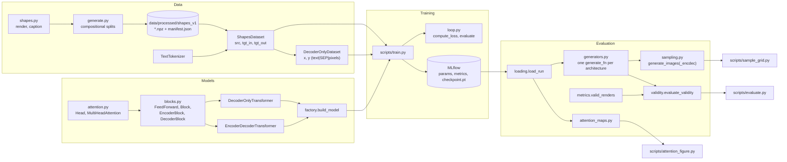
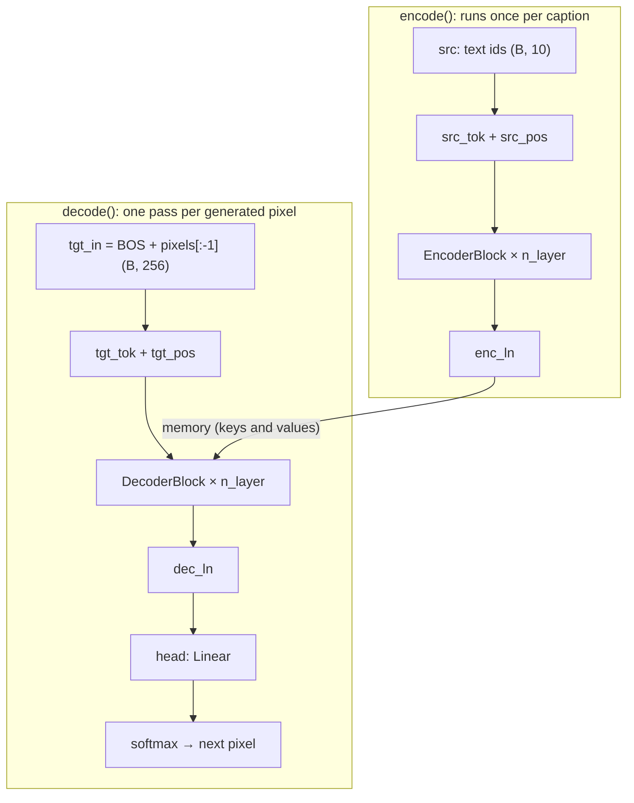

# pixel-text2image

A text-to-pixel-art generator (16×16) trained from scratch with a Transformer
**encoder-decoder** (seq2seq), compared against a **decoder-only** (GPT-style) baseline.
It includes a study of compositional generalization (color-shape combinations never seen
during training) with experiment tracking in MLflow.

> Status: work in progress.

## Demo
_(add a GIF or a link to the Hugging Face Space)_

```
"a small red circle left of a large blue square"  →  16×16 image
```

## Research questions
- Does an encoder-decoder generalize better than a decoder-only model to unseen combinations?
- What does the decoder look at in the text while painting each region? (cross-attention maps)

_Future work:_ effect of dataset size and of the fraction of held-out combinations.

## Key results

Training: 5000 steps, batch size 64, AdamW (lr 3e-4), seed 0, Apple MPS.
Evaluation: 1000 captions per split, one sampled image per caption (temperature 1.0).
`valid_rate` is the fraction of generated images that match **exactly** one of the valid
renders of the described scene (any jitter).

| Model | Parameters | val loss | valid_rate `test_iid` | valid_rate `test_comp` |
|---|---|---|---|---|
| decoder-only (4 blocks) | 0.84M | 0.0187 | 0.824 | 0.749 |
| encoder-decoder (2+2 blocks) | 0.96M | 0.0209 | 0.665 | 0.532 |
| encoder-decoder (4+4 blocks) | 1.89M | 0.0190 | 0.825 | 0.764 |

`test_comp` contains only held-out color-shape pairs (blue circle, red triangle,
green cross, yellow square).

**Reading (one seed per model; interpret with caution):**
- At a similar size, the encoder-decoder (2+2) is clearly worse; with 4+4 blocks it matches
  the decoder-only model. The initial gap was mostly due to decoder depth.
- No advantage of the encoder-decoder in compositional generalization was found; the drop
  from `test_iid` to `test_comp` is similar (−7.5 vs −6.1 points).
- Validation loss barely separates the models even though their validity differs a lot,
  which is why models are compared with `valid_rate`.
- Failure analysis: color, shape and spatial relation are almost always right; what fails
  is fine geometry (stray pixels, size, spacing between large objects).

_Figures (`reports/figures/`):_ failure grids and cross-attention maps.

## Software architecture

### Overview



Design idea: `evaluate_validity` does not know which model is behind it; it receives a
function `generate_fn(captions) -> images`. Each architecture provides its own
(`generators.py`), so both go through exactly the same evaluation code.

### Repository layout

```
configs/            data/shapes_16.yaml, experiments/*.yaml
src/pixelgen/
  data/             shapes, generate, tokenizer, dataset, dataset_gpt, viz
  models/           attention, blocks, decoder_only, encoder_decoder, factory
  training/         loop (compute_loss, evaluate, count_params, ...)
  evaluation/       metrics, sampling, generators, validity, loading, attention_maps
scripts/            prepare_data, train, evaluate, sample_grid, attention_figure
tests/              one test file per module
reports/figures/    figures used in this README
```

### How the encoder-decoder is composed



Inside each block (pre-LayerNorm, residual connections):

```
EncoderBlock:  x → ln1 → sa  (MultiHeadAttention, causal=False, pad_mask) → +x
                 → ln2 → ffwd (FeedForward)                                → +x

DecoderBlock:  x → ln1 → sa  (MultiHeadAttention, causal=True)             → +x
                 → ln2 → ca  (MultiHeadAttention, context=memory, pad_mask) → +x
                 → ln3 → ffwd (FeedForward)                                 → +x
```

### Mapping to Figure 1 of *Attention Is All You Need* (Vaswani et al., 2017)

| Component in the original diagram | Code | Notes |
|---|---|---|
| Inputs | `src` from `ShapesDataset` (caption ids, right-padded with `<pad>`) | Word-level tokenizer (`TextTokenizer`) |
| Input Embedding | `EncoderDecoderTransformer.src_tok` | |
| Positional Encoding (encoder) | `src_pos` | **Learned**, not sinusoidal |
| Encoder × N | `self.encoder` = `ModuleList` of `EncoderBlock` | N = `n_layer` |
| Multi-Head Attention (encoder) | `EncoderBlock.sa` = `MultiHeadAttention(causal=False)` | Bidirectional; `pad_mask` hides `<pad>` tokens |
| Add & Norm | `x + sublayer(ln(x))` in every block | **Pre-LN** (the paper uses post-LN) |
| Feed Forward | `FeedForward` (Linear → ReLU → Linear → Dropout, 4× width) | Same as the paper |
| Outputs (shifted right) | `tgt_in = [BOS] + pixels[:-1]` | Teacher forcing; built by `ShapesDataset` |
| Output Embedding | `tgt_tok` | Vocabulary: 9 colors + BOS |
| Positional Encoding (decoder) | `tgt_pos` | Learned, 1D over the 256 pixels in raster order |
| Masked Multi-Head Attention | `DecoderBlock.sa` = `MultiHeadAttention(causal=True)` | Lower-triangular `tril` mask inside `Head` |
| Multi-Head Attention (cross) | `DecoderBlock.ca`, called with `context=memory` | Queries from the decoder; keys and values from the encoder output |
| Decoder × N | `self.decoder` = `ModuleList` of `DecoderBlock` | |
| Linear | `self.head` | Projection to pixel logits |
| Softmax → Output Probabilities | `F.cross_entropy` (training); `F.softmax` + `torch.multinomial` in `generate_images_encdec` | Sampling is restricted to the 9 colors |
| Scaled Dot-Product Attention | `Head.forward`: `q @ kᵀ / √head_size` → masks → softmax → `@ v` | |
| Multi-Head (concat + projection) | `MultiHeadAttention`: concatenates heads, applies `proj` | Heads are a list of `Head` modules, not fused |

Differences from the paper: learned positional embeddings, pre-LN, and a final `LayerNorm`
in the encoder (`enc_ln`) and decoder (`dec_ln`), which is common with pre-LN.

### The decoder-only baseline

`DecoderOnlyTransformer` uses the same `Head` / `MultiHeadAttention` / `FeedForward` building
blocks, but has no encoder and no cross-attention: it stacks only `Block`s (causal
self-attention + feed-forward). The text is a prefix of the same sequence,
`[text (10) | SEP | pixels (256)]`, and the loss is computed only on the pixels (text
positions are marked with `-100`). In terms of the diagram, this removes the whole left
half and the cross-attention layer.

## How to reproduce

```bash
python -m venv .venv && source .venv/bin/activate
pip install -e ".[dev]"
make data        # generates data/processed/shapes_v1 and sanity-check figures
make test

# training (each script prints its run_id)
python scripts/train.py --config configs/experiments/decoder_only_base.yaml
python scripts/train.py --config configs/experiments/encoder_decoder_base.yaml
python scripts/train.py --config configs/experiments/encoder_decoder_l4.yaml

# evaluation (logs the metrics to the same MLflow run)
python scripts/evaluate.py --run-id <run_id> --n-samples 1000

# figures
python scripts/sample_grid.py --run-id <run_id> --failures-only
python scripts/attention_figure.py --run-id <encoder_decoder_run_id> --index 0 --layer 3

# MLflow UI
python -m mlflow ui --backend-store-uri sqlite:///mlflow.db
```

Always run from the project root (the MLflow database is `mlflow.db`, a relative path).

## Data
Synthetic shapes dataset (16×16, 9-index palette: background + 8 colors; 4 shapes, 2 sizes,
positions and spatial relations, one- and two-object scenes) with compositional splits
(`train`, `val`, `test_iid`, `test_comp`). See `configs/data/shapes_16.yaml` and
`data/README.md`. Each split is recorded with its SHA-256 hash in `manifest.json`.

## Limitations
- A single training seed per model; there are no error bars across training runs.
- `valid_rate` is a strict (exact-match) metric: a single wrong pixel counts as a failure.
- The one-object groups in `test_comp` have few examples, so their percentages are noisy.
- Cross-attention maps are illustrative; they do not prove what the model relies on.
