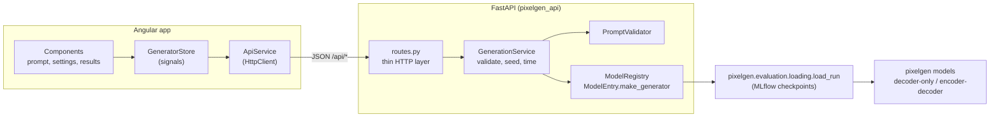

# pixelgen web app

A local web app to try the trained models: type a short description, pick one or both
models and get 16×16 pixel-art images side by side.

- **Backend**: FastAPI (`app/backend`) — loads the trained models and serves a small JSON API.
- **Frontend**: Angular, standalone components and signals (`app/frontend`).

Everything runs on your machine; nothing is hosted.

## Run it

All commands are run from the **project root** (the MLflow database and the dataset paths
stored in each run are relative to it).

### 1. Install

```bash
pip install -e ".[dev,app]"          # see "pyproject.toml additions" below
cd app/frontend && npm install && cd ../..
```

Angular 20 needs Node 20.19+ (or 22.12+).

### 2. Choose the models

`app/backend/models.yaml` lists the MLflow runs to serve (a run needs its `checkpoint.pt`
artifact). Edit the `run_id`s to serve other runs.

### 3. Start

Development, with hot reload (two terminals):

```bash
python -m uvicorn --app-dir app/backend pixelgen_api.main:app --port 8000
cd app/frontend && npm start          # http://localhost:4200  (proxies /api to :8000)
```

Single process, as a finished app:

```bash
cd app/frontend && npm run build && cd ../..
python -m uvicorn --app-dir app/backend pixelgen_api.main:app --port 8000
# http://localhost:8000  (FastAPI serves the built frontend)
```

The API loads the models at startup, so the first start takes a few seconds.

### 4. Test

```bash
python -m pytest app/backend/api_tests
cd app/frontend && npm test -- --no-watch --browsers=ChromeHeadless
```

The backend tests use fake models, so they need neither torch nor checkpoints.

## Architecture



Layers and responsibilities:

| Layer | File | Responsibility |
|---|---|---|
| HTTP | `routes.py`, `main.py` | Parse requests, map errors to one JSON envelope, serve the built frontend. No business logic. |
| Use case | `services/generation.py` | Validate the prompt, seed the sampler, run each model, time it. Depends only on abstractions. |
| Domain rules | `services/prompt.py` | Normalise a prompt and check it against the vocabulary. Pure Python. |
| Catalogue | `services/registry.py` | Describe the served models; the only place that imports torch / mlflow (lazily). |
| Contract | `schemas.py`, `frontend/.../api.models.ts` | The JSON shapes shared by both sides. |
| State | `core/state/generator.store.ts` | Single source of truth of the screen; components only read signals and call intent methods. |

Design decisions worth knowing:

- **Dependency injection for testability.** `create_app(settings, service)` accepts a ready-made
  service; tests pass one built with fake models, so the HTTP layer is tested without torch.
- **Models are hidden behind `generate_fn(captions) -> images`.** The same abstraction the
  evaluation scripts use; adding a model means adding an entry to `models.yaml`.
- **Validation on both sides.** The frontend mirrors the vocabulary check for instant feedback
  (unknown words are highlighted with suggestions); the server re-validates every request.
- **Reproducibility.** Every response carries the seed that was used. All selected models are
  seeded identically, so comparisons are made under the same sampling conditions.
- **One error envelope.** `{"error": {"code", "message", "details"}}` for domain errors,
  validation errors and unexpected failures; the UI switches on `code`, never on text.
- **Blocking inference stays off the event loop.** `POST /api/generate` is a plain `def`, so
  FastAPI runs it in a worker thread; a lock serialises sampling because PyTorch's random
  state is global.
- **Images travel as palette indices** (`pixels[row][col]`) plus the palette, not as PNGs:
  the payload is tiny and the canvas draws crisp, resolution-independent pixels.

## API

| Method | Path | Description |
|---|---|---|
| GET | `/api/health` | Liveness probe. |
| GET | `/api/models` | Served models (id, label, kind, parameter count, description). |
| GET | `/api/vocabulary` | Vocabulary, word groups, max length, palette and example prompts. |
| POST | `/api/generate` | `{prompt, models[], n_variants, temperature, seed?}` → images per model. |

Interactive docs are available at `http://localhost:8000/docs`.

Error codes: `empty_prompt`, `prompt_too_long`, `unknown_words` (with `details.unknown` and
`details.suggestions`), `unknown_model`, `invalid_request`, `internal_error`.

## UX notes

- Live feedback while typing: word count, recognised words, unknown words with one-click fixes.
- Word chips grouped by size / color / shape, and examples taken from the real dataset —
  including **held-out combinations** the models never saw in training.
- Side-by-side comparison with timing, seed copy / reuse, and PNG download per image.
- Loading skeletons, a clear empty state, errors with a retry action, and a disabled Generate
  button that always says why.
- Keyboard: `Ctrl/⌘ + Enter` generates; focus rings, labels and live regions for screen
  readers; respects dark mode and reduced motion; works down to phone width.
- The last prompt and settings are remembered in the browser (`localStorage`, optional).

## `pyproject.toml` additions

```toml
[project.optional-dependencies]
app = ["fastapi>=0.115", "uvicorn[standard]>=0.30", "httpx>=0.27"]
```

## `Makefile` additions

```make
api:        ## start the API (loads the models)
	python -m uvicorn --app-dir app/backend pixelgen_api.main:app --port 8000

web:        ## start the Angular dev server
	cd app/frontend && npm start

app-build:  ## build the frontend so the API can serve it
	cd app/frontend && npm install && npm run build

app-test:
	python -m pytest app/backend/api_tests
	cd app/frontend && npm test -- --no-watch --browsers=ChromeHeadless
```

## Ideas for later

- A tab with the cross-attention maps (`pixelgen.evaluation.attention_maps`) for the
  encoder-decoder.
- Show whether each generated image is a *valid render* of the prompt (`valid_renders`).
- Docker image, if it is ever deployed.
